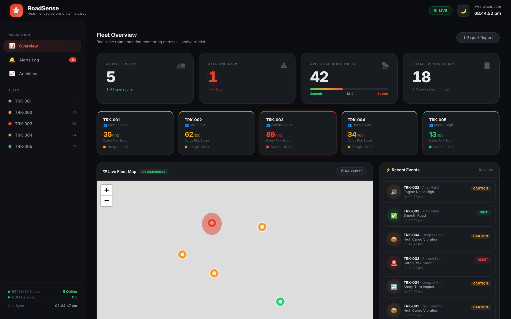
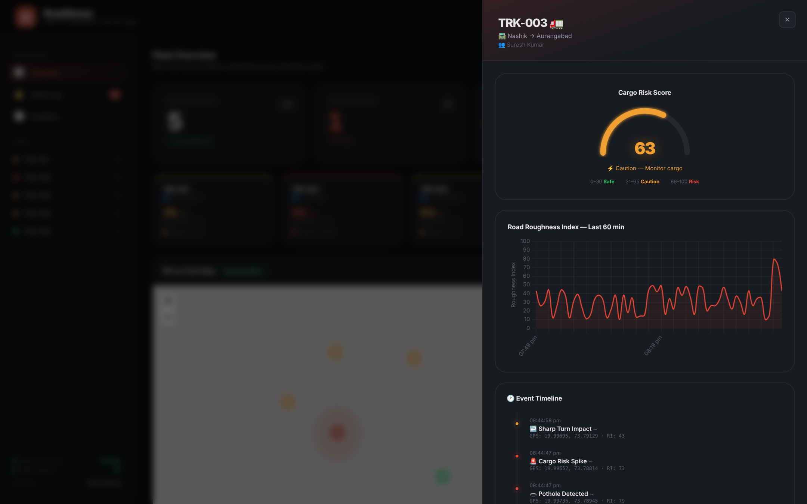

<div align="center">

# 🚛 RoadSense

### *Hear the road before it hits the cargo.*

Fleet intelligence dashboard for an ESP32-based road-condition and cargo-risk sensing system.




</div>

---

## The problem

Rough roads damage cargo, wear out trucks, and nobody finds out until the delivery is late or the goods arrive broken. Fleet operators usually see this only *after* the fact, as a damage claim or a surprise repair bill.

## The idea

RoadSense puts a small sensor node on the truck. It listens to **vibration** (accelerometer) and **tyre/engine noise** (microphone), tags the reading with **GPS**, and boils it down to two numbers a fleet manager can act on:

| Metric | What it tells you |
|---|---|
| **Road Roughness Index (RI)** | How bad the road under the truck is right now |
| **Cargo Risk Score (0–100)** | How likely the cargo is to be getting damaged |

Both are bucketed the same way everywhere in the UI:

| Score | Status | Meaning |
|---|---|---|
| 0–30 | 🟢 Safe | Cargo secure |
| 31–65 | 🟡 Caution | Monitor cargo |
| 66–100 | 🔴 Risk | Cargo at risk |

Flagged events carry GPS coordinates, so rough stretches can be mapped and trucks flagged for predictive maintenance.

---

## ⚠️ Current status: simulated data

**This dashboard currently runs on simulated telemetry.** A built-in generator produces random events for 5 demo trucks along Maharashtra routes (Mumbai → Pune → Nashik → Aurangabad → Solapur → Kolhapur) every 3.5–6 seconds. Nothing is read from real hardware yet. The "5 Online" and "GSM Gateway OK" indicators in the sidebar are static placeholders.

The hardware prototype is built separately (see below). Wiring the two together is the next milestone (see [Roadmap](#roadmap)).

---

## Dashboard features

- **Live fleet map**: Leaflet + OpenStreetMap, markers colour-coded by risk, route polylines, re-center button
- **Fleet overview**: active trucks, trucks alerting now, average roughness, events today
- **Per-truck cards**: cargo risk score and roughness at a glance
- **Real-time event feed**: potholes, pothole clusters, speed bumps, sharp-turn impacts, high cargo vibration, engine noise, cargo risk spikes
- **Truck detail panel**: animated risk gauge, 60-minute roughness chart, event timeline with GPS
- **Alerts log**: filter by all / road / cargo, clear non-critical alerts
- **Analytics**: road-condition distribution, average roughness per route, predictive maintenance flags
- **CSV export**: download the latest events
- **Dark / light theme** toggle
- **Zero build step**: one `index.html`, libraries loaded from CDN

<div align="center">

</div>

---

## Hardware prototype

| Component | Role |
|---|---|
| ESP32 dev board | Main MCU, data processing |
| MPU6050 | Accelerometer, vibration and impact sensing |
| MAX4466 / MAX9814 mic module | Tyre and engine noise |
| NEO-6M | GPS position |
| SIM800L | GSM / SMS uplink |
| microSD module *(optional)* | Local logging |
| Li-ion + TP4056 | Battery and charging |

Sensor, GPS and mic data move between modules over UART. For cellular dead zones the design uses **store-and-forward**: readings are buffered on the node and sent by SMS/GPS once signal returns.

The demo target is a **toy RC truck** with the modules mounted on the cargo bed.

---

## Architecture

```
 ┌──────────────── Truck node ────────────────┐
 │ MPU6050 ─┐                                 │
 │ Mic ─────┼─► ESP32 ──► risk score ─┐       │
 │ NEO-6M ──┘   (UART)                │       │
 │                          SD buffer ◄┤       │
 └─────────────────────────────────────┼───────┘
                                       ▼
                               SIM800L (GSM)
                                       │
                      ┌────────────────┴──────────────┐
                      │  Backend / gateway (planned)  │
                      └────────────────┬──────────────┘
                                       ▼
                       This dashboard (index.html)
                  today: simulated feed ── tomorrow: real feed
```

---

## Run it locally

No install, no build.

```bash
git clone https://github.com/<your-username>/roadsense.git
cd roadsense
python -m http.server 8000
```

Open <http://localhost:8000>. (Opening `index.html` directly also works, but a local server is the safer habit.)

An internet connection is needed for the CDN libraries, Google Fonts and map tiles.

## Deploy

It is a static site, so **GitHub Pages** is the easiest option:

1. Push this repo to GitHub.
2. **Settings → Pages → Build and deployment**: source **Deploy from a branch**, branch `main`, folder `/ (root)`.
3. After a minute it is live at `https://<your-username>.github.io/roadsense/`.

Netlify or Vercel also work: drag the folder in, no build command needed.

---

## Tech stack

- **Frontend:** vanilla HTML / CSS / JavaScript, [Inter](https://rsms.me/inter/) font
- **Map:** [Leaflet](https://leafletjs.com/) 1.9.4 with OpenStreetMap tiles
- **Charts:** [Chart.js](https://www.chartjs.org/) 4.4.3
- **Hardware:** ESP32, MPU6050, NEO-6M, SIM800L

## Project structure

```
roadsense/
├── index.html      # the entire dashboard
├── docs/           # README screenshots
└── README.md
```

## Roadmap

- [ ] Replace the simulator with a real data feed from the ESP32 (backend or gateway to receive GSM/SMS payloads)
- [ ] Define and document the cargo-risk scoring formula from real IMU and audio data
- [ ] Calibrate thresholds on the RC-truck prototype
- [ ] Persist event history instead of keeping it in memory
- [ ] Mobile layout for the dashboard
- [ ] Demo video of the physical prototype

## Acknowledgements

Map data © [OpenStreetMap](https://www.openstreetmap.org/copyright) contributors. Map library by [Leaflet](https://leafletjs.com/).

## License

Not yet chosen. Add a `LICENSE` file (MIT is a common default for portfolio projects) before making the repo public.

---

<div align="center">

Built by **Amrita Raj** · [amritaraj0518@gmail.com](mailto:amritaraj0518@gmail.com)

</div>
